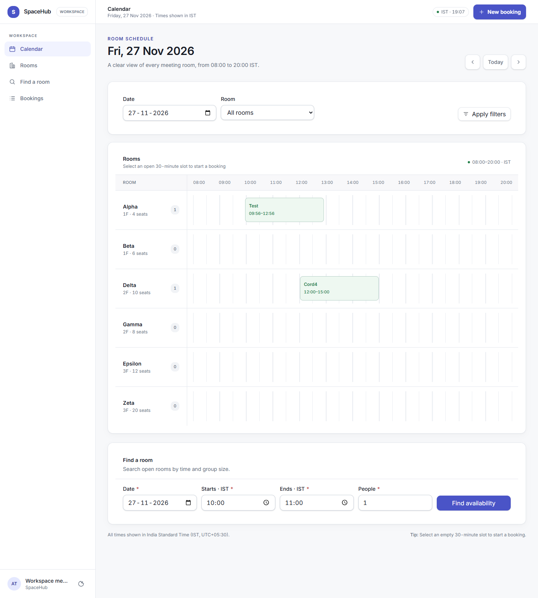
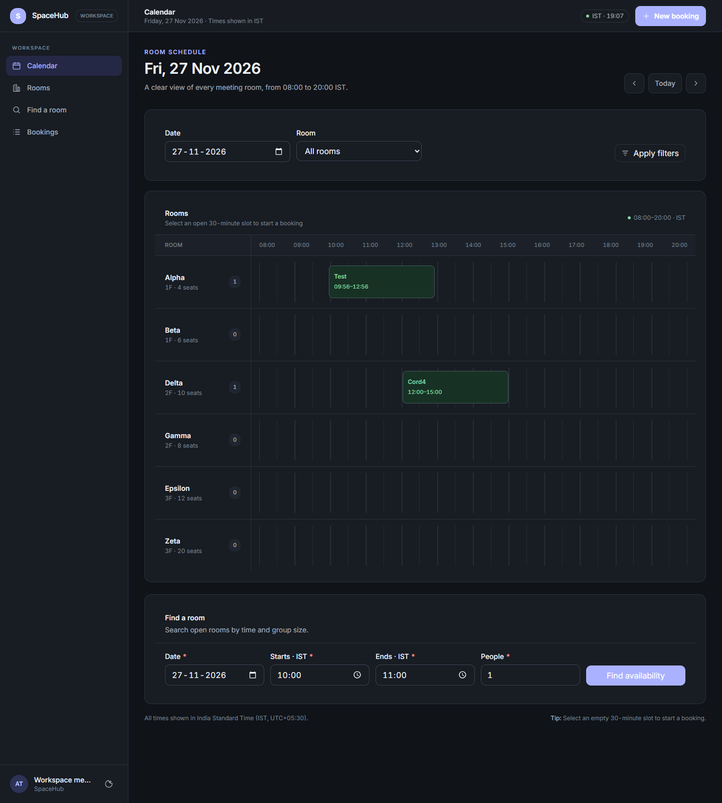

# SpaceHub

SpaceHub is a small internal meeting-room booking app for a co-working space. It replaces chat and paper tracking with a shared schedule, conflict-safe bookings, and room availability search.

## Run with Docker

Docker Compose builds the app and assets, starts PHP-FPM, Nginx, and MySQL, creates the application key when needed, waits for MySQL, then migrates and seeds the database.

```sh
docker compose up --build
```

Open the app at [http://localhost:8080](http://localhost:8080). MySQL data is kept in the named `mysql_data` volume and survives container restarts. `docker compose down` preserves it; `docker compose down -v` removes it.

On first startup, database migrations and seeding run before PHP-FPM is marked healthy; Nginx waits for that health check. If needed, use `docker compose ps` and wait for the `app` service to show `healthy` before opening the URL.

The six seeded rooms are Alpha (4, 1F), Beta (6, 1F), Gamma (8, 2F), Delta (10, 2F), Epsilon (12, 3F), and Zeta (20, 3F). The seed is safe to rerun.

## UI screenshots

The schedule uses the same layout in both appearances; the theme toggle in the sidebar switches between system, light, and dark and remembers the selection.

| Light mode                                                              | Dark mode                                                             |
| ----------------------------------------------------------------------- | --------------------------------------------------------------------- |
|  |  |

### Lighthouse

Lighthouse 13.6.0 mobile emulation against the Docker app measured **76 Performance**, **100 Accessibility**, and **81 Best Practices**. The 90+ target was not met for Performance or Best Practices. Lighthouse reported one Fenced Frame API deprecation warning attributed to the JavaScript bundle; the built bundle does not contain a reference to that API, so the warning remains unresolved.

## UI architecture

- **App shell:** responsive sidebar navigation, page context, persistent theme control, and a global booking action.
- **Calendar:** desktop timeline across the six rooms, mobile per-room agenda, date and room filters, and a live current-time indicator. Selecting an open slot opens the booking drawer with its room and times filled in.
- **Booking drawer:** server-validated form, inline field errors, duration feedback, conflict details, and preserved input. Selecting a booking opens its details panel and a confirmation dialog for cancellation.
- **Rooms:** directory cards show capacity, floor, and current in-use status; floor and minimum-capacity filters narrow the list.
- **Find a room:** search by date, time range, and people. Result cards link back to a prefilled booking drawer.
- **Bookings:** searchable and sortable paginated table for date, room, status, and booker.
- **Components and assets:** anonymous Blade components share controls, cards, badges, dialogs, tables, and states. Tailwind CSS v4 design tokens live in `resources/css/app.css`; Alpine uses its CSP build from `resources/js/app.js`. Inter is self-hosted through Fontsource; no CDN assets or SPA framework are used.

Primary UI URLs:

- Calendar: [http://localhost:8080/](http://localhost:8080/)
- Rooms: [http://localhost:8080/rooms](http://localhost:8080/rooms)
- Find a room: use the **Find a room** section on the calendar, or open a results URL such as `/rooms/available?date=2030-01-02&start_time=10%3A00&end_time=11%3A00&people=5`
- Bookings list: [http://localhost:8080/?view=list](http://localhost:8080/?view=list)

## Checks and development

Run the test suite, Pint check, or Larastan from the running app container:

```sh
docker compose exec -e APP_ENV=testing app composer test
docker compose exec app composer lint
docker compose exec app composer analyse
```

The test command sets `APP_ENV=testing` so Laravel uses the PHPUnit SQLite configuration instead of the running app's MySQL environment.

Format code on the host with `composer format`. After cloning, install the pre-commit hook once:

```sh
git config core.hooksPath .githooks
```

The hook formats and stages changed PHP, Blade, CSS, JavaScript, and documentation files, then runs static analysis and tests. CI runs the same PHP checks plus Prettier and a production asset build. Tests use an in-memory SQLite database via `phpunit.xml`; the running application uses MySQL 8.

For frontend-only changes on a host with Node.js, run:

```sh
npm ci
npm run format:frontend
npm run format:frontend:check
npm run build
```

Docker builds the production assets automatically.

GitHub Actions runs Pint, Larastan, PHPUnit, Prettier, and the production Vite build on pushes and pull requests.

## API

All API responses use JSON. Validation errors have the shape `{"message":"...","errors":{"field":["..."]}}`.

### Rooms

`GET /api/rooms` returns the room directory:

```json
{
    "data": [
        { "id": 1, "name": "Alpha", "capacity": 4, "floor": "1F" },
        { "id": 2, "name": "Beta", "capacity": 6, "floor": "1F" }
    ]
}
```

### Create a booking

`POST /api/bookings` accepts ISO 8601 datetimes with the SpaceHub timezone offset:

```sh
curl -X POST http://localhost:8080/api/bookings \
  -H "Content-Type: application/json" \
  -d '{
    "room_id": 1,
    "title": "Product planning",
    "booked_by": "Aman",
    "start_time": "2030-01-02T10:00:00+05:30",
    "end_time": "2030-01-02T11:00:00+05:30"
  }'
```

Success returns `201 Created`:

```json
{
    "data": {
        "id": 1,
        "room_id": 1,
        "room": "Alpha",
        "title": "Product planning",
        "booked_by": "Aman",
        "start_time": "2030-01-02T10:00:00+05:30",
        "end_time": "2030-01-02T11:00:00+05:30",
        "status": "confirmed"
    }
}
```

Overlapping active bookings return `409 Conflict` and name the existing booking:

```json
{
    "message": "Product planning (10:00 - 11:00) is already booked for this room.",
    "errors": {
        "start_time": ["Product planning (10:00 - 11:00) is already booked for this room."]
    }
}
```

### List and cancel bookings

- `GET /api/bookings?date=2030-01-02&room_id=1` lists that day's bookings, optionally for one room. Cancelled bookings remain visible with `status: "cancelled"`.
- `DELETE /api/bookings/1` changes the booking status to cancelled and returns the cancelled booking. Cancelling again returns `422` with a clear message.

### Find available rooms

`GET /api/rooms/available?date=2030-01-02&start_time=10%3A00&end_time=11%3A00&people=5` returns rooms that fit the group and have no active overlapping booking. Availability times use `HH:mm` in the requested date and the app timezone.

## Design choices and assumptions

- Laravel 12, PHP 8.3, MySQL 8, Blade, Tailwind CSS, Vite, PHPUnit, Pint, and Larastan.
- The app is for an internal, trusted network and has no authentication or authorization.
- All booking times use `Asia/Kolkata`. Bookings must be for one day, start no earlier than 08:00, end by 20:00, and last at most four hours. The end must be later than the start.
- A booking blocks a slot exactly when `existing.start < requested.end AND existing.end > requested.start`. Therefore, adjacent bookings are allowed.
- Cancellation is a status change, not deletion. Cancelled bookings do not block availability and remain in the schedule for reference.
- Booking creation locks the room row with `lockForUpdate` inside a database transaction before checking overlap and inserting. This serializes competing booking attempts for a room on MySQL; SQLite is used only for the fast automated tests and does not verify MySQL locking behavior.
- Datetimes are stored as timezone-local MySQL `DATETIME` values and serialized with the app timezone. This is intentionally a single-timezone internal app.
- The app uses a single-day schedule and does not support authentication, recurring bookings, invitations, or notifications.

## What I would improve with more time

- Add authentication and role-based permissions, with booking ownership tied to an account.
- Add integration/load tests against MySQL for simultaneous booking attempts and verify locking under contention.
- Add configurable opening hours, booking notifications, and deeper accessibility audits with real assistive technology.
- Add richer booking-list actions and room-status summaries if the co-working workflow needs them.

## AI tools

Copilot SDK in VS Code assisted with implementation, UI iteration, targeted feature tests, and documentation. I used the repository's Docker Compose stack for runtime verification and ran PHPUnit, Pint, Larastan, Prettier, and Vite checks; generated suggestions were reviewed and adjusted against the existing Laravel code and test behavior.
